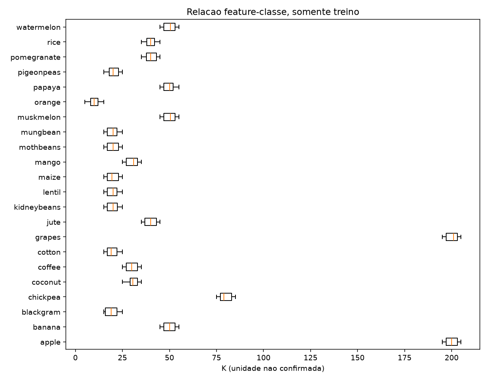

# Entrega 1 — síntese

2026-11-08 · Números: [EDA do treino](../../reports/data/eda.json) e [EXP-001](../../reports/metrics/EXP-001.json) · Material completo: [notebook](../../notebooks/00_entrega_parcial.ipynb).

## Problema e objetivo

O objetivo é construir um modelo que, a partir de sete medições de solo e clima (`N`, `P`, `K`, `ph`, `temperature`, `humidity`, `rainfall`), **indique qual das 22 culturas do dataset corresponde àquelas condições**: uma classificação multiclasse. *Exemplo:* N, P, K, pH, temperatura, umidade e chuva medidos → `rice`, `maize`, `coffee` etc.

Usuário-alvo: **produtor rural ou agrônomo** que precisa de uma primeira indicação de cultura. É uma prova de conceito acadêmica: apoia, mas não substitui, a avaliação agronômica. O modelo final fica para a Entrega 2.

## Base de dados

| Item | Valor |
|---|---|
| Fonte | Crop Recommendation Dataset (origem declarada: Kaggle `atharvaingle`), lido de cópia no GitHub fixada no commit `a90b2ed` |
| Tamanho | 2200 linhas × 8 colunas; 22 culturas × 100 linhas; sem nulos e sem duplicatas |
| Divisão | 80 % treino (1760) e 20 % teste reservado (440), estratificada, seed 42; **toda a análise usa só o treino** |

| Variável | Grupo | O que representa |
|---|---|---|
| `N`, `P`, `K` (inteiros) | solo | nitrogênio, fósforo e potássio |
| `ph` | solo | acidez do solo |
| `temperature`, `humidity`, `rainfall` | clima | temperatura, umidade e chuva |
| `label` | alvo | cultura (22 categorias) |

Unidades não informadas pela fonte; valores na escala original.

## Principais achados da EDA

- As **22 culturas estão perfeitamente balanceadas** (80 por cultura no treino). Isso não reflete a frequência real das culturas.
- **Algumas variáveis separam bem certos grupos.** `K` acima de 190 só aparece em `apple` e `grapes` (nas demais, no máximo 85). A chuva de `rice` (mediana 233) não se sobrepõe à de `maize` (mediana 84).
- **Nenhuma variável sozinha separa todas as culturas.** Todas têm pares de culturas sobrepostos (ver Variáveis relevantes); a classificação precisa combinar variáveis.
- **`P` e `K` são correlacionados** (r de Pearson = 0,7360). As demais correlações são fracas (|r| ≤ 0,2294).
- **Valores extremos não foram tratados como erro.** Os 160 valores extremos de `K` (regra do IQR) caracterizam culturas específicas; decidimos manter todas as observações.

## Hipóteses

Hipóteses exploratórias (HE), formuladas após a EDA inicial e checadas descritivamente no treino; não são confirmatórias.

| Hipótese | Resultado no treino |
|---|---|
| HE1: mediana de `N` em `cotton` > `orange` | 115 > 19; sustentada |
| HE2: mediana de `humidity` em `chickpea` < `rice` | 16,64 < 82,16; sustentada |
| HE3: mediana de `rainfall` em `rice` > `maize` | 233,42 > 84,23; sustentada |
| HE4: correlação P–K positiva | r = 0,7360; sustentada, sem demonstrar equivalência |

## Variáveis relevantes

As sete entradas são mantidas: cada uma mostra contraste entre culturas.

| Variável | Contraste de medianas | Par sobreposto (Q1–Q3) |
|---|---|---|
| `N` | `cotton` 115, `orange` 19 | `rice`, `maize` |
| `P` | `apple` 137, `orange` 16 | `apple`, `grapes` |
| `K` | `apple` 200, `maize` 19,50 | `apple`, `grapes` |
| `temperature` | `chickpea` 18,89, `muskmelon` 28,89 | `rice`, `cotton` |
| `humidity` | `chickpea` 16,64, `rice` 82,16 | `apple`, `orange` |
| `ph` | `kidneybeans` 5,75, `chickpea` 7,36 | `apple`, `grapes` |
| `rainfall` | `rice` 233,42, `maize` 84,23 | `apple`, `orange` |

## Metodologia

| Decisão | Escolha | Por quê |
|---|---|---|
| Tratamento | Sem remoção ou limitação de extremos; sem imputação (não há nulos) | Extremos caracterizam culturas, não são erros comprovados |
| Escalonamento | `StandardScaler` só na regressão logística e no MLP, ajustado em cada fold | Sensíveis à escala, ao contrário das árvores; ajuste por fold evita vazamento |
| Baseline | `DummyClassifier` (sempre a mesma classe) | Desempenho mínimo sem aprender nada |
| Candidatos | Regressão logística, árvore de decisão, Random Forest, XGBoost, LightGBM, MLP | Famílias diferentes: linear, árvore, ensembles e rede neural |
| Métrica | F1 macro (também precisão e recall) | Mesmo peso às 22 culturas; equilibra precisão e recall |
| Validação | CV estratificada, 5 folds, seed 42, **só no treino** | Estima o desempenho sem tocar o teste reservado |

## Primeiro experimento (EXP-001)

Hiperparâmetros fixos (em geral, padrões das bibliotecas). F1 macro médio ± desvio-padrão em 5 folds ([relatório](../../reports/experiments/EXP-001.md)):

| Modelo | F1 macro |
|---|---|
| Random Forest | 0,9948 ± 0,0052 |
| LightGBM | 0,9909 ± 0,0051 |
| XGBoost | 0,9892 ± 0,0068 |
| MLP | 0,9863 ± 0,0071 |
| Árvore de decisão | 0,9834 ± 0,0087 |
| Regressão logística | 0,9686 ± 0,0090 |
| Dummy (baseline) | 0,0040 ± 0,0000 |

- **Todos superam muito o baseline**, em cada fold: as sete variáveis juntas distinguem as culturas *neste dataset*.
- **Não há vencedor claro:** os cinco primeiros diferem na ordem de 1–2 desvios-padrão. Random Forest, LightGBM e XGBoost seguem para o ajuste de hiperparâmetros.
- A regressão logística, mais interpretável, fica cerca de 0,026 abaixo da Random Forest, o que pode indicar relações em parte não lineares.
- *Cautela:* escores próximos de 0,99 numa base perfeitamente balanceada podem não se repetir com dados reais.

## Dificuldades e próximos passos

**Dificuldades encontradas**

- A fonte não informa unidades, métodos nem período de medição.
- Sem licença declarada, o CSV não é redistribuído.
- O balanceamento perfeito e as faixas estreitas sugerem dados gerados ou aumentados (hipótese a verificar).
- Modelos tecnicamente empatados dificultam a escolha só pela métrica.

**Próximos passos (Entrega 2)**

1. Ajustar hiperparâmetros dos três melhores por CV no treino.
2. Escolher o modelo por desempenho, estabilidade e interpretabilidade.
3. Avaliar **uma única vez** no conjunto de teste reservado.
4. Explicar o modelo (SHAP; matriz de confusão por cultura).
5. Discutir a viabilidade de uso real (custo das medições, validação agronômica).

## Limitações

- Associação descritiva não comprova causalidade.
- Sem prescrição de plantio ou adubação; resultados valem para este dataset.
- O conjunto de teste reservado ainda não foi usado.
